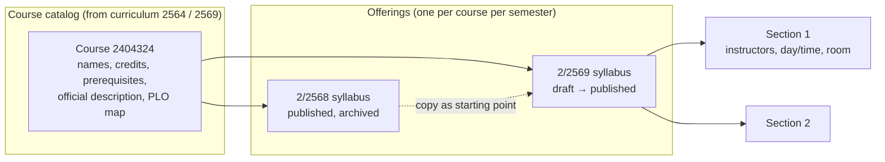
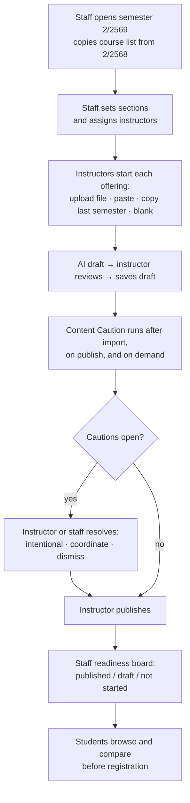

# 01 — Refined concept: PA CoursePlat

> Working name **PA CoursePlat** (แพลตฟอร์มกลางรายวิชา ภาควิชารัฐประศาสนศาสตร์). A demo of a central syllabus platform for the Public Administration department, Faculty of Political Science, Chulalongkorn University. This file is the "why and what". Specs 02–08 are the "how".

## Goal

Give the PA department one shared place where every course's semester syllabus is stored in the same structured form, so that (1) professors can see what other courses already teach and assign before they finalise their own, and (2) students can understand a course before they register for it. The demo must be convincing enough to present the solution to the department, at 90–100% working.

## The problem, stated precisely

Every semester each professor writes the syllabus for the courses they teach, alone, usually as a Word file that goes to students on day one. Nobody sees the whole picture before the semester starts. Four things go wrong as a result:

1. **Content and work overlap.** Two courses teach the same topic at the same depth (for example the policy-cycle model in both 2404324 Public Policy and 2404429 Advanced Public Policy Analysis), assign the same core reading, or set nearly the same assignment (a two-page policy brief due in week 11 in one course and week 12 in the other). Students who take both pay twice for the same learning.
2. **Continuity breaks.** When a course passes to a new professor, or one course is taught by several professors (team teaching, or parallel sections), the previous plan and its lessons are not handed over in a usable form.
3. **Students choose blind.** Before registration a student only sees the two-line official description (คำอธิบายรายวิชา). They cannot tell how a course is taught, how heavy it is, how it is graded, or whether it repeats something they have taken. Choosing the wrong elective has a real opportunity cost: a 3-credit slot, a semester's effort, and possibly a track requirement.
4. **The department has no early warning.** Overlaps are discovered by students halfway through the semester, when it is too late to fix them.

Not all overlap is bad. Curriculum scaffolding is deliberate: 2400114 Introduction to Public Administration introduces Weber and scientific management so that 2404436 Public Organization Theories can go deeper. The platform must tell **deliberate scaffolding** apart from **accidental duplication**, or professors will rightly ignore it.

## Who it serves

| User | Logs in with | What they need to get done |
|---|---|---|
| Student (นิสิต, PolSci) | `XXXXXXXX24@student.chula.ac.th` | Understand a course before registering; compare electives; see workload across the courses they plan to take |
| Instructor (อาจารย์) | `@chula.ac.th` and listed in the department directory | Publish a syllabus with little effort (upload the Word/PDF they already have); see overlaps with other courses before students do; hand over to the next instructor |
| Department staff / course coordinator (เจ้าหน้าที่ภาค / ผู้ประสานงานหลักสูตร) | `@chula.ac.th`, role `staff` in the directory | Open a semester, decide which courses and sections run, assign instructors, chase missing syllabi, review and resolve overlaps |
| Curriculum committee / head of department | as staff | See whether the semester's courses together cover the programme learning outcomes (PLO 1D–5D) and where content is duplicated |

## How the platform answers the four objectives

| Objective (from the brief) | Mechanism in the platform | What the demo shows |
|---|---|---|
| Teaching continuity (ความต่อเนื่องในการสอน) | Each course keeps a history of past semester syllabi. A new offering can start as a copy of the last one. Handover notes pass from instructor to instructor. "What changed since last offering" diff. | 2404429's previous instructor left a note that week 2 repeated 2404324; the new instructor sees it when she opens the course |
| Planning when several professors teach (การวางแผนกรณีมีอาจารย์หลายคน) | One syllabus per course per semester, shared by all its sections. Each week of the plan names who teaches it. Parallel sections show side by side. | 2404412 P.A. Workshop taught by three instructors in week blocks; 2400114 with two sections taught by different instructors |
| Student opportunity cost (opportunity cost ในการลงเรียน) | Course pages answer "what, how, how heavy, how graded" in one screen. Compare up to three courses. Combined weekly workload heatmap. Badges say whether the course is required for this student's curriculum and major. Related-courses panel. | A student compares two policy-track electives (2404422, 2404429) with the required 2404324 and sees weeks 11–12 pile up |
| Students understand the course before it starts (ความเข้าใจในรายวิชาก่อนเริ่มเรียน) | Structured, plain-language syllabus with objectives, approach, evaluation, resources, work, professors, sections and timetable, published before registration | The student opens 2404324 and gets the whole picture in about 30 seconds |
| Content Caution (เช็คเนื้อหาทับซ้อน) | Automatic check against every other PA course: same topic, same reading, same kind of assignment. Each caution explains itself and is resolved by a person as intentional, coordinate, or dismiss. | Shown in a dashboard only professors and staff can open. Uploading 2404429's syllabus raises one high caution (duplicate policy brief), medium cautions on the policy-cycle weeks and the M&E week, and a shared-reading caution |

## Five design decisions that refine the original idea

### 1. Separate the course from its semester offering

A **course** (2404324 นโยบายสาธารณะ) is stable. Its code, names, credits, prerequisites, official description and PLO mapping come from the curriculum document and change only when the curriculum is revised (2564, 2569). An **offering** (2404324 in 2/2569) is what a professor writes each semester: the syllabus, sections, instructors and timetable. Keeping the two apart is what makes continuity possible: every offering of the same course stacks into a history, and the official layer never has to be retyped.

### 2. One syllabus structure, two ways in, and people decide what is published

Every syllabus, however it arrives, lands in the same structured schema (spec 02). There are three ways in:

- **Upload** the Word (.docx), PDF (including scanned) or a photo. AI reads it and fills in the form.
- **Paste** the text.
- **Fill in** the manual form, or start from last semester's copy.

AI only ever produces a **draft** with a confidence level and a source quote for each part. The professor reviews it on a side-by-side screen and publishes it. Nothing AI-generated reaches students without a person pressing Publish.

### 3. Content Caution explains itself and distinguishes scaffolding from duplication

Each caution names the two items (course, week, topic or assignment), shows them side by side, gives a one-line reason, and carries a relation:

- **Duplicate (ซ้ำซ้อน)**: same scope and depth, no prerequisite link
- **Builds on (ต่อยอด)**: one is the foundation and the other goes deeper, often along a prerequisite or course level
- **Related (เกี่ยวข้อง)**: shares a theme; for information only

Severity (high, medium, info) follows from the relation, the kind of item and the strength of the match (rules in spec 06). The person resolves each caution as **intentional**, **coordinate** (opens a thread with the other instructor) or **dismiss**. Cautions live in a **Content Caution dashboard that only professors and staff can open**: tiles by severity, a course × course matrix showing where the overlaps are, and the list of cautions to resolve. Staff see the whole department; each professor sees the cautions that involve their own courses. Students never see cautions or anything derived from them; their related-courses panel is built from prerequisites only. Overlap labels are sensitive among colleagues, and a similarity score shown to students would embarrass professors without helping anyone.

### 4. Edit rights are scoped, not domain-wide

Every Chula staff member in every faculty has an `@chula.ac.th` address, so "anyone with @chula.ac.th can edit" would let any of them edit PA syllabi. Instead:

- `@chula.ac.th` sign-in gives **read access** by default (role `viewer`).
- The department keeps a **staff directory** (allowlist). A listed address gets `instructor` or `staff` on its first sign-in.
- An instructor can edit only the offerings they are assigned to (any section of that offering). Staff can edit all offerings and manage semesters, sections and the directory.

### 5. Students get decision support, not just documents

- **Curriculum-aware badges.** The student ID in the email gives the entry cohort (`67xxxxxx24` is cohort 67, curriculum 2564; cohort 69 and later is curriculum 2569). The student picks their major once. Each course then says "บังคับสาขา (PA)", "วิชาเลือกกลุ่ม: สายนโยบายและการวางแผน" or "วิชาเลือก".
- **At-a-glance card.** Estimated hours per week, evaluation mix, teaching style, language, sections and times.
- **Compare (2–3 courses).** Aligned sections, shared topics highlighted, combined weekly workload heatmap.

## The nine information sections (what every course page shows)

The brief lists nine sections. This is how each is defined and where its data comes from. The weekly plan was not in the brief by name, but overlap checking depends on it, so it lives under **Timetable** (ตารางเรียนและแผนการสอนรายสัปดาห์).

| # | Section (TH) | Contents | Source | Edited by |
|---|---|---|---|---|
| 1 | Course Overview · ภาพรวมรายวิชา | Code, TH/EN names, credits `3 (3-0-6)`, prerequisites, curriculum status badges, official description (catalog), **this semester's focus** (2–6 sentences), language, delivery mode, estimated workload, keywords | Catalog + syllabus | Catalog: staff. Focus etc.: instructor |
| 2 | Objectives · วัตถุประสงค์และผลลัพธ์การเรียนรู้ | Course learning outcomes (CLOs), each mapped to PLO codes (PLO1D…PLO5D) | Syllabus | Instructor |
| 3 | Classroom Approach · แนวทางการจัดการเรียนการสอน | Teaching methods (controlled list from the curriculum), description, attendance policy, AI-use policy, late-work policy | Syllabus | Instructor |
| 4 | Evaluation · การวัดและประเมินผล | Items with weight %, type, individual/group, due week; grading scheme (A–F or S/U); criterion/norm referencing; optional cut-offs. Shown as a donut. | Syllabus | Instructor |
| 5 | Class Resources · เอกสารและทรัพยากรการเรียนรู้ | Readings (required/recommended, full citation, link/ISBN/DOI), materials, platforms (MyCourseVille etc.) | Syllabus | Instructor |
| 6 | Work (optional) · งานที่มอบหมาย | Assignments: title, type, description, deliverable, individual/group, due week, linked evaluation item, estimated hours | Syllabus | Instructor |
| 7 | Professor (Section) · อาจารย์ผู้สอน | Each instructor: title, name, contact, office hours, which sections and which weeks they teach | Profiles + sections + weekly plan | Staff assigns; instructor edits own contact and office hours |
| 8 | Timetable · ตารางเรียนและแผนการสอน | Meeting day/time/room per section; week-by-week plan (topic, concepts, instructor, readings, activity); key dates (midterm, final, deadlines) | Sections + syllabus | Staff (meetings), instructor (plan, own section's meetings) |
| 9 | Section · ตอนเรียน | Section number, language, capacity, instructors, meeting times, notes (for example "ตอนเรียนภาษาอังกฤษ") | Sections | Staff; instructor edits notes for own sections |

## Semester lifecycle

Timing fits the presentation: today (November 2026) is the end of semester 1/2569, and professors are preparing 2/2569 syllabi before students register. The demo is set in exactly that window.

## Scope of the demo

**In (must work in the presentation):** Supabase sign-in with role rules and demo accounts; seeded catalog (34 PA courses with official descriptions, PLOs, curriculum 2564/2569 categories); seeded semesters 2/2568, 1/2569 and 2/2569 with about 14 offerings in 2/2569; student browse, filter, course page with all nine sections; instructor editor (manual form) with validation and autosave; AI import from .docx, .pdf, image and pasted text with a review screen, plus an offline fallback; Content Caution (rules + AI + seeded results) with its professor/staff dashboard and the resolve flow; staff readiness dashboard; history, copy from last semester and handover notes.

**Should (build if time allows, all specced):** compare page with workload heatmap; PLO coverage matrix; diff against last offering; related-courses panel.

**Out (non-goals for the demo):** integration with the university registration system (no public API; sections and times are typed or seeded); departments other than PA; enrolment and grades; email notifications (in-app only); native mobile app; production-grade PDPA documentation (spec 03 notes what a pilot would need).

## Success criteria for the presentation

The audience (department professors and staff) should leave believing three things, each backed by a moment in the demo script (spec 08):

1. "Putting my syllabus in costs me less than five minutes": upload a Word file, review, publish.
2. "It catches real overlaps and respects intentional ones": the caution on 2404429 and the resolved "builds on" between 2400114 and 2404436.
3. "Students would use this before registering": the course page and compare view on a phone-sized screen.

If the department pilots it, measure: share of offerings published before registration opens; median minutes from upload to publish; cautions raised versus resolved and how they were resolved; student survey item "I understood what this course involves before I registered" (before and after).

## Risks and how the design handles them

| Risk | Mitigation |
|---|---|
| Professors don't adopt it (one more form) | Upload the file they already have; copy last semester; the AI does the typing; publishing stays one click |
| Overlap labels cause friction between colleagues | Cautions only in the professor/staff dashboard, each professor seeing only their own courses' pairs; neutral wording; "builds on" is a first-class outcome; every decision is recorded with a note |
| AI misreads or invents content | Draft-only, per-section confidence with source quotes, human publish, schema validation; the AI is never asked to judge a person |
| Live demo fails (network, API key, rate limit) | `AI_OFFLINE` fixtures for the sample files and seeded cautions; a `demo:reset` command to rehearse repeatedly |
| Free AI services: Gemini's daily quota is low; both Google (free tier) and ThaiLLM may use submitted content to develop their models; ThaiLLM is a research service with no availability guarantee | Gemini only for documents (one call per upload), ThaiLLM for overlap judging (200 requests a minute), each the other's fallback where possible; graceful failure to the manual form and to rule-based checks; fictional demo data; contact details redacted; a notice on the upload page; `AI_OFFLINE` fixtures; paid tier or a department agreement before any real pilot |
| Chula Google accounts block third-party OAuth | Decision point D3 below; Microsoft (Azure) provider as fallback; demo accounts work regardless |
| Sharing creditGPAX's Supabase project lets one app break the other | PA CoursePlat keeps everything in its own `courseplat` schema with its own migration script; one shared sign-up rule that keeps creditGPAX's; scripts that only touch PA CoursePlat data; nothing that can block creditGPAX's account deletion (spec 02) |
| Real course codes next to fictional professors could mislead | All seeded people and syllabi are fictional and the UI shows a "ข้อมูลตัวอย่างเพื่อการสาธิต" (demo data) badge; footer says this is not an official university system |

## Decision points (defaults chosen; override before or during build)

| ID | Decision | Default in these specs | Alternative |
|---|---|---|---|
| D1 | Syllabus granularity | One syllabus per offering, shared by all its sections; per-section notes | Separate syllabus per section |
| D2 | Which students may sign in | PolSci students only (`…24@student.chula.ac.th`), as briefed | Any `@student.chula.ac.th` (minors and free-elective students from other faculties) |
| D3 | Sign-in provider | Google OAuth through Supabase (same as creditgpax, not yet verified against a live Chula account) | Microsoft (Azure AD) provider if Chula's Google Workspace blocks third-party apps |
| D4 | Who sees cautions | Only professors and staff, in the Content Caution dashboard: staff see all, a professor sees pairs involving their own courses; nothing caution-derived on student pages | Every professor sees the whole department's matrix (one RLS policy change) |
| D5 | Team-taught editing | Every assigned instructor can edit the shared syllabus; coordinator owns publish | Only the coordinator edits |
| D6 | Which official description to show | Curriculum 2569 text for all cohorts | Per-cohort text (2564 for cohorts 66–68) |
| D7 | PLO framework for CLO mapping | 2569 PLOs (PLO1–5, PLO1D–5D) for all offerings | Keep 2564 PLOs for courses taken mainly by cohorts 66–68 |
| D8 | AI providers | Two free services, server-side keys: Google Gemini API free tier (project `pa-courseplat-1`, `gemini-flash-latest` pinned before presenting) reads documents; ThaiLLM (`typhoon`, chosen by the judge evaluation) judges Content Caution pairs and backs up text extraction | Gemini for everything (`AI_CAUTION_PROVIDER=gemini`); Gemini paid tier for a real pilot; any provider behind the same `generateJson()` interface |
