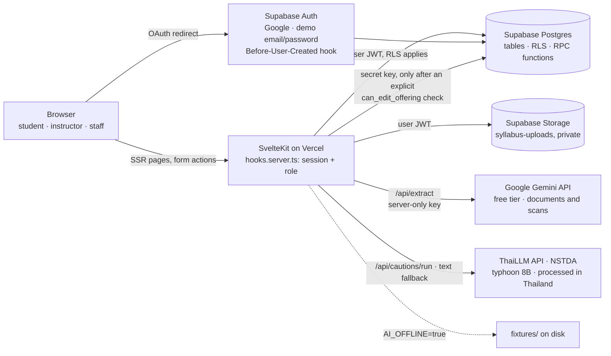
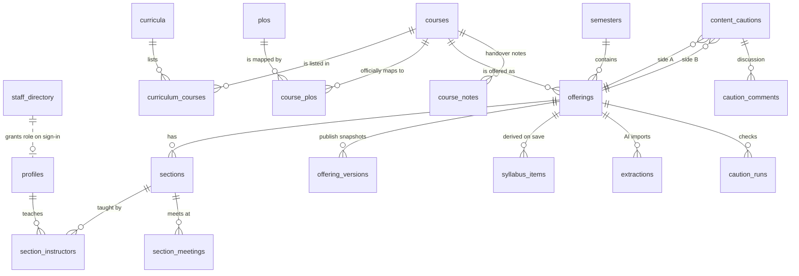

# 02 — Architecture, data model and syllabus schema

## Goal

Fix the technical foundation every other spec builds on: the stack, the repository layout, the database (tables, functions, row-level security), file storage, and the one **syllabus schema** that the manual form, the AI import, the student pages and Content Caution all share.

## Requirements

- R1. One TypeScript schema (`src/lib/schema/syllabus.ts`, Zod) is the single source of truth for the syllabus document: editor validation, server validation, the AI output schema (converted to JSON Schema) and the seed fixtures all use it.
- R2. All writes that need permission checks go through Postgres functions (`security definer`) or row-level-security (RLS) policies. The browser never holds a secret key.
- R3. Saving a syllabus is compare-and-swap on a `revision` number, so two instructors editing a team-taught syllabus cannot silently overwrite each other.
- R4. Every save rebuilds `syllabus_items` (one row per topic, reading, assignment and objective), which is what Content Caution compares.
- R5. Every publish stores an immutable snapshot in `offering_versions` (history, diff, "copy from last semester").
- R6. Works on Vercel (Hobby plan is enough) and on `npm run dev` locally, against the Supabase project shared with creditGPAX, without changing anything creditGPAX relies on (see "Shared Supabase project").
- R7. Thai text renders correctly everywhere (fonts Prompt for headings, Sarabun for body, as in creditgpax).

## Proposed approach

### Stack (assumptions, override if needed)

Chosen to match Kim's existing creditgpax project, so components and patterns can be copied.

| Layer | Choice | Notes |
|---|---|---|
| App | SvelteKit 2, Svelte 5 (runes), TypeScript strict | `@sveltejs/adapter-vercel` (server routes are needed for the AI key; creditgpax was static) |
| Styling | Tailwind CSS 4 | `@fontsource/prompt`, `@fontsource/sarabun` |
| Backend | Supabase: Auth, Postgres + RLS, Storage | `@supabase/supabase-js`, `@supabase/ssr` for cookie sessions in SvelteKit |
| Validation | Zod 4 | `z.toJSONSchema()` for the AI output schema |
| AI | Two free providers behind one interface, server only: **Google Gemini API** (free tier, `@google/genai`) and **ThaiLLM** (NSTDA's national Thai LLM platform, OpenAI-compatible, `openai` SDK with a custom base URL) | Gemini reads uploaded documents (PDFs including scans, images, and .docx converted to text) with `responseJsonSchema`; ThaiLLM judges Content Caution pairs and is the fallback for .docx/text extraction. Routing table in "AI providers" below. |
| DOCX reading | `mammoth` (HTML output, then a small HTML→markdown pass that keeps tables) | |
| Sample-file generation | `docx` (npm) and Playwright + `pdf-lib` | Only in `scripts/make-samples.ts` |
| Tests | Vitest (unit), Playwright (e2e, projects `webkit` and `chromium`) | Kim audits in Safari, so WebKit must pass |

Vercel functions on Fluid compute default to 300 s on all plans, which comfortably covers a 20–60 s extraction call. Still set `export const config = { maxDuration: 120 }` on the two AI routes.

### Architecture



The server uses the **user's** Supabase client (JWT, RLS applies) for everything it can. The secret-key client (`src/lib/server/admin.ts`) is used in exactly two places: writing Content Caution rows (they reference other instructors' offerings) and the seed/reset scripts. Each use is preceded by `can_edit_offering()` called with the user's JWT.

### Shared Supabase project (with creditGPAX)

PA CoursePlat uses Kim's existing Supabase project, which already runs creditGPAX's account and plan sync (`public.accounts`, `public.plan_docs`, `public.grade_docs`, its functions, and its Before User Created hook `public.hook_before_user_created`). These rules keep each app from breaking the other:

1. **Own schema.** Every PA CoursePlat table, type, function, trigger and policy lives in schema `courseplat`. Nothing in `public` is created or changed, except the one shared hook in rule 3. Clients use `createClient(url, key, { db: { schema: 'courseplat' } })`. Add `courseplat` to the exposed schemas (Dashboard → Settings → Data API) and grant `usage` on the schema plus table and function privileges to `anon`, `authenticated` and `service_role`; follow Supabase's current guide for custom schemas. Functions use `set search_path = courseplat, pg_temp`.
2. **Own migration ledger.** creditGPAX's SQL was run by hand in the SQL editor, so the project's Supabase CLI migration history does not describe it. Never run `supabase db push` or `supabase db reset` against the shared project. `npm run db:migrate` (`scripts/migrate.ts`, the `postgres` npm package, `SUPABASE_DB_URL`) applies `supabase/migrations/*.sql` in order, each in a transaction, and records them in `courseplat.schema_migrations`. For local work, `supabase start` and the same script with the local URL.
3. **One shared sign-up hook.** A project has a single Before User Created hook. Create `public.shared_before_user_created(event jsonb)`, the only object PA CoursePlat adds to `public`, which allows either app's users: Google + PolSci student address (creditGPAX's rule unchanged, and PA CoursePlat's students), Google + `@chula.ac.th` (PA CoursePlat staff), or the email provider + an address in `courseplat.demo_accounts`. Point the dashboard hook at it, and leave creditGPAX's `public.hook_before_user_created` in place, unused. creditGPAX's data stays protected because its functions and policies re-check the Google provider and the PolSci address on every call: staff and demo accounts can sign in but cannot read or write anything of creditGPAX's.
4. **No profile trigger on `auth.users`.** A trigger would create PA CoursePlat profiles for every creditGPAX sign-up, and creditGPAX users who already exist would never get one. Instead, `courseplat.ensure_profile()` runs when someone signs in to PA CoursePlat (spec 03).
5. **Never block user deletion.** creditGPAX's `delete_my_account()` deletes from `auth.users`. Every PA CoursePlat foreign key that points at a person is either `on delete cascade` (`profiles.id`, `section_instructors.profile_id`) or nullable with `on delete set null` (coordinators, resolvers, `created_by`, `updated_by`, `published_by`, `added_by`, and the author columns of `caution_comments` and `course_notes`, which therefore drop `not null`; the UI shows "ผู้ใช้ที่ลบบัญชีแล้ว"). Deleting a user from either app must always succeed.
6. **Scripts stay in their lane.** `seed` and `demo:reset` touch only schema `courseplat`, the `syllabus-uploads` bucket, and auth users whose email is in `courseplat.demo_accounts`. They never touch other auth users or `public`.
7. **Shared settings.** Auth URL configuration keeps creditGPAX's Site URL. Add PA CoursePlat's callback URLs to the redirect list, and always pass `redirectTo` explicitly, or Supabase sends people to creditGPAX's site. The Google provider uses creditGPAX's Google OAuth client, so Google's consent screen shows that client's app name: rename it in Google Cloud to something that fits both apps, or accept it for the demo. The Email provider must be on for the demo accounts; the shared hook still refuses every other email sign-up. creditGPAX's scheduled `keepalive()` call keeps the free project from pausing, which also helps the demo.

### Environment variables

| Name | Where | Purpose |
|---|---|---|
| `PUBLIC_SUPABASE_URL`, `PUBLIC_SUPABASE_PUBLISHABLE_KEY` | client + server | Supabase project (publishable key only) |
| `SUPABASE_SECRET_KEY` | server, scripts | Caution writes, seed, reset. Never sent to the browser. From the dashboard (the same project as creditGPAX). |
| `SUPABASE_DB_URL` | scripts only | Postgres connection string (Dashboard → Connect), used by `npm run db:migrate`; never used by the running app |
| `GEMINI_API_KEY` | server | Gemini API key from Google AI Studio (project `pa-courseplat-1`). Lives in `.env` only. |
| `AI_MODEL` | server | Default `gemini-flash-latest`; pin a concrete model before presenting |
| `AI_FALLBACK_MODEL` | server | Used once on a 429; default `gemini-3.5-flash-lite` |
| `AI_TIER` | server | `free` (default) shows the free-tier data notice on the import page; `paid` hides it |
| `AI_MAX_CALLS_PER_HOUR` | server | Per-user cap on Gemini calls; default 6 |
| `THAILLM_API_KEY` | server | ThaiLLM key (Kim's, from thaillm.or.th). Lives in `.env` only. |
| `THAILLM_BASE_URL` | server | Default `https://thaillm.or.th/api/v1` |
| `THAILLM_MODEL` | server | Default `typhoon`; set from the judge evaluation (spec 06) |
| `AI_CAUTION_PROVIDER` | server | `thaillm` (default) or `gemini`: who judges Content Caution pairs |
| `AI_EXTRACT_FALLBACK` | server | `thaillm` (default) or `none`: fallback for .docx/text extraction when Gemini's quota is used up |
| `AI_OFFLINE` | server | `true` = never call the API; use `fixtures/` (spec 05, 06) |
| `PUBLIC_DEMO_MODE` | client + server | Shows demo sign-in buttons and the demo-data badge |
| `DEMO_ACCOUNT_PASSWORD` | server, scripts | Shared password of seeded demo accounts; used server-side by `/auth/demo` |

Commit `.env.example` with every name and no values. `.env` is git-ignored, and so are `api.md` and `thaillm-api.md` (they hold Kim's keys in plain text).

### AI providers: Google Gemini API (free tier) and ThaiLLM

Kim's team has two free AI services: the Gemini API free tier (key from Google AI Studio, project `pa-courseplat-1`, details in `api.md`) and ThaiLLM (details in `thaillm-api.md`). They are good at different things, so each gets the jobs it fits:

| Task | Primary | Fallback | Why |
|---|---|---|---|
| Extract a syllabus from a PDF (text or scanned) or an image | Gemini | none: manual form | Needs document vision; ThaiLLM's models are text-only, and Thai PDF text layers often lose tone marks (as the curriculum PDF did) |
| Extract a syllabus from .docx or pasted text | Gemini, one call | ThaiLLM, four section-sized calls | Gemini handles the large schema in one pass; ThaiLLM's 200-requests-a-minute limit easily covers four calls when Gemini's daily quota is used up |
| Judge Content Caution pairs (spec 06, Stage 2) | ThaiLLM, one small call per candidate pair | Gemini, one corpus call | Keeps Gemini's daily quota for documents; short Thai item pairs suit 8B models; processing stays in Thailand |

`AI_CAUTION_PROVIDER` and `AI_EXTRACT_FALLBACK` switch the routing. Everything goes through one interface, so changing a provider, or moving Gemini to the paid tier, touches one file each (decision D8).

**Interface** (`src/lib/server/ai/generate.ts`, server only; providers in `ai/providers/gemini.ts` and `ai/providers/thaillm.ts`):

```ts
generateJson<T>(opts: {
  provider: 'gemini' | 'thaillm';
  kind: 'extract' | 'compare' | 'judge';
  system: string;                  // → config.systemInstruction
  parts: Part[];                   // { text } | { inlineData: { mimeType, data /* base64 */ } }
  schema: ZodType<T>;              // validated after the call, always
  maxOutputTokens: number;
}): Promise<{ data: T; model: string; modelVersion: string; usage: { input: number; output: number } }>
```

#### Gemini (`src/lib/server/ai/providers/gemini.ts`)

For Gemini it calls `ai.models.generateContent({ model: AI_MODEL, contents: [{ role: 'user', parts }], config: { systemInstruction, responseMimeType: 'application/json', responseJsonSchema: toGeminiSchema(z.toJSONSchema(schema)), maxOutputTokens, temperature: 0.2 } })` with `@google/genai`, then `JSON.parse(response.text)` and `schema.parse(...)`. It records `response.usageMetadata` and `response.modelVersion`. Google's docs now also show a newer Interactions API. Stay on `generateContent` (it is still documented and is what `api.md` uses), and check field names against the current SDK at build time.

**Inputs.** PDFs (text or scanned) go in as `inlineData` with `application/pdf`. Gemini reads PDFs with full vision, including image-only pages, up to 50 MB and 1,000 pages, which is far more than any syllabus needs. Images go in as `inlineData` with their MIME type. .docx is not a document type Gemini reads natively, so it is converted to text with `mammoth` first (spec 05), as is pasted text.

**Schema subset** (`toGeminiSchema()`). Gemini supports a subset of JSON Schema and silently ignores the rest: `type` (nullable as `["string","null"]`), `title`, `description`, `properties`, `required`, `additionalProperties`, `enum`, `format` (date/time), `minimum`/`maximum`, `items`, `prefixItems`, `minItems`/`maxItems`. The helper keeps those, drops `$schema`, `default`, `minLength`, `maxLength` and `pattern`, and fails loudly on `$ref`, `anyOf` and `oneOf` (the app's schemas must not need them; model maps such as `meta` as objects with explicit properties). Schema-valid output is not guaranteed to be correct, which is why Zod validates every response. If Gemini rejects the extraction schema as too large, split extraction into two calls (overview, objectives, approach, evaluation; then weekly plan, resources, work, key dates, hints) and merge.

**Free-tier limits.** Limits are per project, shown only in AI Studio, and lower than the paid tier; the daily quota resets at midnight Pacific time (15:00 Bangkok time from November to March, 14:00 from March to November). The design spends quota carefully:

- One call per extraction and one per caution run; no AI on autosave (spec 05, 06).
- At most `AI_MAX_CALLS_PER_HOUR` (default 6) AI calls per user, counted from `ai_calls`.
- On HTTP 429: wait once if the error's retry delay is 20 s or less; otherwise retry once with `AI_FALLBACK_MODEL`; otherwise fail with "โควตา AI แบบไม่เสียค่าใช้จ่ายของวันนี้เต็มแล้ว (รีเซ็ตเวลา 15:00 น.)". Extraction then offers the manual form; a caution run keeps its Stage 1 results.
- Every call is logged in `ai_calls`; staff see today's count on `/admin` (spec 07).

**Data use on the free tier.** Free-tier usage counts as Google's "Unpaid Services": Google may use prompts and responses to improve its products, human reviewers may read them, and Google asks users not to submit sensitive, confidential or personal information. The demo's syllabi and people are fictional, so the demo is fine. Rules for the app:

- Send only the one syllabus document and public catalog context; never student data.
- Before sending text (.docx, pasted text, comparison corpora), run `redactContacts()` to replace email addresses and phone numbers with placeholders.
- When `AI_TIER=free`, the import page shows: "ไฟล์นี้จะถูกส่งไปประมวลผลด้วย Google Gemini (บริการแบบไม่เสียค่าใช้จ่าย) ซึ่ง Google อาจนำข้อมูลไปใช้พัฒนาบริการ โปรดอย่าอัปโหลดเอกสารที่มีข้อมูลส่วนบุคคลหรือข้อมูลลับ" (PDFs and images cannot be redacted on the server, so the notice covers them).
- Before a real pilot with real syllabi, enable billing on the Google Cloud project (paid-tier data terms apply to all usage once billing is active) or get the department's agreement to the free-tier terms.

**Model choice.** `AI_MODEL` defaults to `gemini-flash-latest`, the alias in `api.md`. An alias can move to a newer model without notice, so before the presentation, set `AI_MODEL` to the concrete model that `response.modelVersion` reported when the offline fixtures were recorded. The free-tier column of the pricing page lists models such as `gemini-3.8-flash`, `gemini-3.6-flash` and `gemini-3.5-flash-lite` (November 2026); price changes are scheduled for December 2026 to January 2027, so re-check that the chosen model is still free shortly before presenting. `AI_FALLBACK_MODEL` defaults to `gemini-3.5-flash-lite`.

#### ThaiLLM (`src/lib/server/ai/providers/thaillm.ts`)

ThaiLLM is the national Thai LLM platform (NSTDA with MDES, BDI, NECTEC and partners). It is free, and requests are processed on supercomputers in Thailand (ThaiSC). Kim's details are in `thaillm-api.md`.

- **API.** OpenAI-compatible chat completions: `POST {THAILLM_BASE_URL}/chat/completions` with `Authorization: Bearer <THAILLM_API_KEY>`, the model chosen by shorthand in the body. Use the `openai` npm SDK with `baseURL` and `apiKey`. The older path-based endpoint in `thaillm-api.md` is not needed.
- **Models** (all text-only, 8B, built on the ThaiLLM-8B / Qwen3 base): `typhoon` (Typhoon-S-ThaiLLM-8B-Instruct, SCB 10X; instruction-tuned Thai/English, 32K context; **default**), `pathumma` (NECTEC; a thinking model that writes its reasoning before the answer), `openthaigpt` (AIEAT; fine-tuned at 8K context, too short for extraction), `thalle` (KBTG; finance-oriented). Choose `THAILLM_MODEL` with the judge evaluation in spec 06, not by reputation.
- **Rate limits** (from `thaillm-api.md`): 5 requests per second and 200 per minute; no daily quota is stated. The client keeps at most 3 requests in flight and at most 4 per second, and backs off 1 s, 2 s, 4 s on 429 or 5xx.
- **JSON output.** Ask for `response_format: { type: "json_schema", json_schema: { name, schema, strict: true } }`. If the server rejects that (HTTP 400), retry with `{ type: "json_object" }`, then with plain instructions only. Whatever comes back: remove any `<think>…</think>` block, take the first balanced JSON object, validate with Zod, and allow one repair retry that quotes the validation errors. Keep ThaiLLM schemas small and flat: that is why ThaiLLM gets the short pairwise judging task, and extraction only as four section-sized calls.
- **Context budget.** Keep each request under about 12k prompt tokens (Thai text costs more tokens per character than English); read `usage.prompt_tokens` and log it.
- **Transport.** Use HTTPS: `THAILLM_BASE_URL` defaults to `https://thaillm.or.th/api/v1`. The examples in `thaillm-api.md` use `http://`, which would send the key unencrypted. Only if Kim confirms that HTTPS does not work, switch to `http://`, and record that in `specs/DECISIONS.md`.
- **Terms** (the published terms are for the Playground; ask ThaiLLM whether the API has its own): free, provided as-is with no availability guarantee, and may change or stop without notice; inputs must not contain personal data; the provider may use inputs to develop and train its models; commercial use of outputs needs written consent; the API token must not be passed to others. For this app: run `redactContacts()` on everything sent, keep the demo non-commercial, keep `AI_OFFLINE` ready in case the service is down, and before a department pilot (where other people's actions spend Kim's token), ask ThaiLLM for permission or a department key.
- **Region.** Set the Vercel functions region to `sin1` (Singapore) in `vercel.json`, close to both ThaiLLM and the Supabase project.


### Repository layout

```
pa-courseplat/
  CLAUDE.md                     # pointer to specs, conventions
  specs/  data/                 # these specs; real catalog seed data
  src/
    hooks.server.ts             # Supabase SSR client, session, role → locals
    lib/
      schema/syllabus.ts        # Zod: SyllabusDoc (draft + strict), vocabularies
      schema/extraction.ts      # Zod: AI extraction result
      domain/                   # pure TS, unit-tested
        curriculum.ts           # cohort → curriculum, course badges for a student
        workload.ts             # weekly load per offering / per basket
        weeks.ts                # week number ↔ date from semester.starts_on
        diff.ts                 # field-level diff between two SyllabusDocs
        normalize.ts            # title/text normalisation (Thai + Latin)
      server/
        supabase.ts  admin.ts   # user client / secret client
        ai/generate.ts          # generateJson(): routing, redaction, ai_calls log
        ai/providers/gemini.ts  # @google/genai, schema subset, free-tier 429 policy
        ai/providers/thaillm.ts # openai SDK + base URL, JSON fallbacks, rate limiter
        ai/extract.ts  ai/compare.ts  ai/offline.ts
        docx.ts                 # mammoth → markdown
        cautions/rules.ts  cautions/severity.ts  cautions/run.ts
      components/               # Donut, Heatmap, Badge, Chip, SectionNav, CourseCard,
                                # syllabus/* (read-only views), editor/* (form parts)
      i18n/th.ts                # all UI strings (Thai, with English section names)
    routes/                     # see specs 03, 04, 05, 07
  supabase/
    config.toml
    migrations/0001_schema.sql 0002_functions.sql 0003_rls.sql 0004_auth.sql
                                # schema courseplat; applied by npm run db:migrate
  scripts/migrate.ts seed.ts demo-reset.ts make-samples.ts
  fixtures/
    syllabi/                    # seed SyllabusDocs, one file per offering
    samples/                    # generated upload files + index.json (sha256 → fixture)
    extractions/  cautions/     # offline AI results
  tests/unit/  tests/e2e/
```

Copy, don't import, from creditgpax (`~/Library/CloudStorage/OneDrive-Personal/Project/Local/creditgpax`): `src/lib/components/Donut.svelte`, `Icon.svelte`, the font setup, and the pattern of `supabase/migrations/20261112000000_account_plan_sync.sql` (domain-checked Before-User-Created hook, `security definer` functions with compare-and-swap).

### Data model



Tables (write as `supabase/migrations/0001_schema.sql`, starting with `create schema if not exists courseplat;` and `set search_path = courseplat;`; types and constraints are the contract, exact SQL style is up to you; apply rule 5 above to every foreign key that points at `profiles`):

```sql
create type user_role       as enum ('student','viewer','instructor','staff');
create type major_code      as enum ('GOV','IR','SOC','PA');
create type semester_status as enum ('archived','active','upcoming');
create type offering_status as enum ('not_started','draft','published');
create type caution_kind    as enum ('topic','reading','assignment','objective');
create type caution_relation as enum ('duplicate','builds_on','related');
create type caution_severity as enum ('high','medium','info');
create type caution_status  as enum ('open','intentional','coordinating','dismissed');

-- people
create table profiles (
  id uuid primary key references auth.users on delete cascade,
  email text not null unique,
  role user_role not null,
  cohort smallint,                 -- students: 66, 67, … (first two digits of student ID)
  major major_code,                -- students: chosen at onboarding
  title_th text, name_th text, name_en text,   -- instructors/staff
  office text, office_hours text, contact_note text,
  is_demo boolean not null default false,
  created_at timestamptz not null default now()
);
create table staff_directory (     -- allowlist: who gets instructor/staff on sign-in
  email text primary key check (email = lower(email)),
  role user_role not null check (role in ('instructor','staff')),
  title_th text, name_th text, name_en text,
  added_by uuid references profiles, added_at timestamptz not null default now()
);
create table demo_accounts (       -- only these may use email/password sign-in
  email text primary key, role user_role not null, cohort smallint, major major_code,
  label_th text not null
);

-- catalog (seeded from data/*.json)
create table curricula (id text primary key, name_th text not null, name_en text,
  cohort_min smallint not null, cohort_max smallint);           -- 2564: 66–68, 2569: 69–null
create table plos (code text primary key, curriculum_id text references curricula,
  major major_code, text_th text not null,
  teaching_methods text[] not null default '{}', assessment_methods text[] not null default '{}');
create table courses (
  code char(7) primary key, name_th text not null, name_en text not null, short_name_en text,
  credits numeric(3,1) not null, credit_format text not null, level smallint not null,  -- 5th digit of code
  department text not null, prerequisite_text text, prerequisite_codes char(7)[] not null default '{}',
  description_th text, description_en text, managed_here boolean not null default true
);
create table curriculum_courses (
  id bigint generated always as identity primary key,
  curriculum_id text not null references curricula, course_code char(7) not null references courses,
  major major_code,               -- null = all majors (faculty core)
  category text not null check (category in ('faculty_core','major_required','track_elective','required_elective')),
  track text,                     -- 'pa-fiscal' | 'pa-personnel' | 'pa-policy' | null
  track_name_th text,
  unique (curriculum_id, course_code, major, category, track)
);
create table course_plos (course_code char(7) references courses, plo_code text references plos,
  primary key (course_code, plo_code));   -- "official examples" from the curriculum

-- semesters and offerings
create table semesters (
  id text primary key,            -- '2569-2'
  label text not null,            -- '2/2569'
  year_be smallint not null, term smallint not null check (term in (1,2,3)),
  starts_on date not null, weeks smallint not null default 16,
  status semester_status not null, syllabus_due_on date
);
create table offerings (
  id uuid primary key default gen_random_uuid(),
  course_code char(7) not null references courses, semester_id text not null references semesters,
  status offering_status not null default 'not_started',
  syllabus jsonb,                 -- SyllabusDoc (draft or strict), null when not_started
  revision int not null default 0,
  coordinator_id uuid references profiles,
  cloned_from uuid references offerings,
  updated_by uuid references profiles, updated_at timestamptz,
  published_at timestamptz, published_revision int,
  unique (course_code, semester_id)
);
create table offering_versions (
  id uuid primary key default gen_random_uuid(),
  offering_id uuid not null references offerings on delete cascade,
  revision int not null, syllabus jsonb not null, sections_snapshot jsonb not null,
  published_by uuid references profiles, published_at timestamptz not null default now()
);
create table sections (
  id uuid primary key default gen_random_uuid(),
  offering_id uuid not null references offerings on delete cascade,
  section_no smallint not null, language text not null default 'th' check (language in ('th','en','th_en')),
  capacity smallint, note text not null default '',
  unique (offering_id, section_no)
);
create table section_instructors (
  id uuid primary key default gen_random_uuid(),
  section_id uuid not null references sections on delete cascade,
  profile_id uuid references profiles, guest_name text,
  role text not null default 'lead' check (role in ('lead','co','guest')),
  check (profile_id is not null or guest_name is not null)
);
create table section_meetings (
  id uuid primary key default gen_random_uuid(),
  section_id uuid not null references sections on delete cascade,
  weekday smallint not null check (weekday between 1 and 7),   -- 1 = Monday
  starts_at time not null, ends_at time not null check (ends_at > starts_at),
  room text not null default '', mode text not null default 'onsite' check (mode in ('onsite','online','hybrid'))
);

-- derived for Content Caution (rebuilt by save_syllabus)
create table syllabus_items (
  id bigint generated always as identity primary key,
  offering_id uuid not null references offerings on delete cascade,
  kind caution_kind not null,
  ref text not null,              -- 'weeklyPlan:5' | 'readings:r-2' | 'work:w-1' | 'objectives:clo-3'
  week smallint, text text not null, concepts text[] not null default '{}',
  norm_key text,                  -- readings: normalised title (+ isbn/doi)
  content_hash text not null,     -- md5(text) — reopens a resolved caution when content changes
  unique (offering_id, ref)
);

-- AI imports
create table extractions (
  id uuid primary key default gen_random_uuid(),
  offering_id uuid not null references offerings on delete cascade,
  created_by uuid not null references profiles,
  source_kind text not null check (source_kind in ('docx','pdf','image','text')),
  storage_path text, file_sha256 text,
  status text not null check (status in ('running','succeeded','failed')),
  model text, offline boolean not null default false,
  result jsonb, error text, input_tokens int, output_tokens int,
  created_at timestamptz not null default now(), finished_at timestamptz
);

-- Content Caution
create table caution_runs (
  id uuid primary key default gen_random_uuid(),
  offering_id uuid not null references offerings on delete cascade,
  triggered_by uuid references profiles,
  trigger text not null check (trigger in ('manual','save','publish','seed')),
  model text, offline boolean not null default false,
  status text not null check (status in ('running','succeeded','failed')),
  compared_offering_ids uuid[] not null default '{}', error text,
  created_at timestamptz not null default now(), finished_at timestamptz
);
create table content_cautions (
  id uuid primary key default gen_random_uuid(),
  pair_key text not null unique,  -- see spec 06: stable across runs
  semester_id text references semesters,
  a_offering_id uuid not null references offerings on delete cascade, a_ref text not null, a_label text not null,
  b_offering_id uuid not null references offerings on delete cascade, b_ref text not null, b_label text not null,
  kind caution_kind not null, relation caution_relation not null, severity caution_severity not null,
  similarity numeric(3,2) not null, reason_th text not null, suggestion_th text not null default '',
  source text not null check (source in ('rule','ai','seed')),
  status caution_status not null default 'open',
  resolved_by uuid references profiles, resolved_at timestamptz, resolution_note text,
  a_hash text not null, b_hash text not null, last_run_id uuid references caution_runs,
  created_at timestamptz not null default now(), updated_at timestamptz not null default now()
);
create table caution_comments (
  id uuid primary key default gen_random_uuid(),
  caution_id uuid not null references content_cautions on delete cascade,
  author_id uuid not null references profiles, body text not null check (length(body) between 1 and 2000),
  created_at timestamptz not null default now()
);
create table course_notes (        -- handover notes; belong to the course, so they survive offerings
  id uuid primary key default gen_random_uuid(),
  course_code char(7) not null references courses, semester_id text references semesters,
  author_id uuid not null references profiles, body text not null check (length(body) between 1 and 4000),
  created_at timestamptz not null default now()
);

-- AI usage (free-tier quota awareness)
create table ai_calls (
  id bigint generated always as identity primary key,
  provider text not null check (provider in ('gemini','thaillm')),
  kind text not null check (kind in ('extract','compare','judge')),
  model text not null, model_version text,
  status text not null check (status in ('ok','rate_limited','error','offline')),
  http_status smallint, input_tokens int, output_tokens int, latency_ms int,
  created_by uuid references profiles, created_at timestamptz not null default now()
);
```

### The syllabus schema (`src/lib/schema/syllabus.ts`)

Build both variants from one factory, `makeSyllabusSchema({ strict })`. **Draft** (saving) checks structure and types only: everything may be empty. **Strict** (publishing) adds the minimums and cross-checks. Keep ids stable inside a document (`clo-1`, `w-2`, `r-3`, `e-1`), because cautions and diffs refer to them.

```ts
export const PLO_CODES = ['PLO1','PLO2','PLO3','PLO4','PLO5','PLO1D','PLO2D','PLO3D','PLO4D','PLO5D'] as const;
export const TEACHING_METHODS = ['lecture','discussion','case_study','modular','workshop_seminar','role_play',
  'problem_based','game_based','field_visit','independent_study','brainstorming','guest_speaker',
  'internship','flipped','group_project','policy_lab'] as const;          // TH labels: data/plos-2569.json
export const EVAL_TYPES = ['midterm_exam','final_exam','quiz','paper','policy_brief','case_analysis',
  'presentation','project','participation','attendance','reflection','other'] as const;
export const WORK_TYPES = ['paper','policy_brief','case_analysis','presentation','project',
  'fieldwork_report','exercise','reading_response','other'] as const;
export const READING_TYPES = ['book','chapter','article','report','law','web','video','other'] as const;

type SyllabusDoc = {
  schemaVersion: 1;
  overview: {
    focus: string;                       // this semester's focus, 2–6 sentences (strict: ≥ 40 chars)
    language: 'th' | 'en' | 'th_en';
    deliveryMode: 'onsite' | 'online' | 'hybrid';
    workloadHoursPerWeek: number | null; // default from credit format, e.g. 3 (3-0-6) → 6
    keywords: string[];                  // ≤ 10
    prerequisiteNote: string;            // anything beyond the catalog prerequisite
  };
  objectives: { id: string; text: string; ploCodes: PloCode[] }[];          // strict: ≥ 1, each ≥ 1 PLO
  approach: {
    methods: TeachingMethod[];           // strict: ≥ 1
    description: string; attendancePolicy: string;
    aiPolicy: 'not_allowed' | 'allowed_with_disclosure' | 'allowed' | 'unspecified';
    aiPolicyNote: string; lateWorkPolicy: string;
  };
  weeklyPlan: {                          // strict: ≥ 10 rows, unique weeks 1–16
    week: number; topic: string; details: string;
    concepts: string[];                  // ≤ 8 short tags, any language — used by Content Caution
    instructorIds: string[];             // profile ids of this offering's instructors (team teaching)
    readingIds: string[];                // ids from resources.readings
    activity: string; noClass: boolean;  // exam week, holiday
  }[];
  evaluation: {
    gradingScheme: 'letter' | 'su';
    referencing: 'criterion' | 'norm' | 'mixed' | 'unspecified';
    items: { id: string; title: string; type: EvalType; weightPercent: number;
             individual: boolean; dueWeek: number | null; description: string }[];
    cutoffs: { grade: 'A'|'B+'|'B'|'C+'|'C'|'D+'|'D'|'F'; minPercent: number }[];
  };
  resources: {
    readings: { id: string; citation: string; title: string; authors: string; year: number | null;
                type: ReadingType; required: boolean; url: string | null; isbn: string | null; doi: string | null }[];
    materials: string[];
    platforms: { name: string; url: string | null; note: string }[];   // MyCourseVille, Google Classroom…
  };
  work: { id: string; title: string; type: WorkType; description: string; deliverable: string;
          individual: boolean; groupSize: string | null; dueWeek: number | null;
          evaluationItemId: string | null; estimatedHours: number | null }[];   // optional section: may be []
  keyDates: { label: string; week: number | null; date: string | null }[];       // ISO yyyy-mm-dd
};
```

Strict-mode cross-checks (`superRefine`, each with a Thai message and a path so the editor can point at the field):

1. With `gradingScheme = 'letter'`, evaluation weights sum to exactly 100.
2. Week numbers in `weeklyPlan` are unique and within `semester.weeks`.
3. Every `readingIds` entry exists in `resources.readings`; every `evaluationItemId` exists in `evaluation.items`; every `instructorIds` entry is an instructor of this offering (checked on the server, which knows the sections).
4. `dueWeek` values are within the semester.
5. Cut-offs, if present, are strictly decreasing.

A complete, valid example is in `data/examples/2404324-2569-2.json`. Use it in unit tests and as the seed for that offering.

### Database functions (`0002_functions.sql`)

All in schema `courseplat`, `security definer`, `set search_path = courseplat, pg_temp`, granted to `authenticated` only.

| Function | Does | Checks |
|---|---|---|
| `app_role() → user_role` | Role of `auth.uid()` | — |
| `is_staff() → bool` | | |
| `can_view_offering(id) → bool` | Published, or staff, or assigned instructor | |
| `can_edit_offering(id) → bool` | Staff, coordinator, or instructor on any section of the offering | |
| `save_syllabus(offering, doc jsonb, expected_revision) → int` | Writes doc, `revision + 1`, `not_started → draft`, rebuilds `syllabus_items`; returns the new revision | `can_edit_offering`; raise `revision_conflict` on mismatch; doc ≤ 256 KB; `schemaVersion = 1` |
| `publish_offering(offering, expected_revision)` | `status = published`, `published_at`, `published_revision`, insert `offering_versions` with a snapshot of sections, instructors and meetings | `can_edit_offering`; ≥ 1 section; objectives non-empty; letter grading sums to 100 (the server has already run strict Zod; this is a backstop) |
| `unpublish_offering(offering)` | Back to `draft` | `can_edit_offering` |
| `clone_offering(target, source_version)` | Copies a published snapshot's syllabus into the target as a draft; clears `keyDates[].date` and `weeklyPlan[].instructorIds`; sets `cloned_from` | `can_edit_offering(target)` |
| `resolve_caution(id, status, note)` | Sets status, `resolved_by/at`, note | Staff or instructor of either side |
| `update_section_details(section, note, meetings jsonb)` | Replaces meetings and note | Staff, or instructor on that section |
| `update_my_profile(title_th, name_th, name_en, office, office_hours, contact_note, major)` | Self-service fields only | Self |
| `norm_title(text) → text` | `lower`, NFC, drops edition markers like `(15th ed.)`, keeps `[[:alnum:]ก-๙]` only | — |

`rebuild_syllabus_items(offering)` (called by `save_syllabus`) emits:

- `topic`: one row per `weeklyPlan` entry with `noClass = false`. `text = topic || ' — ' || details`, `concepts` copied, `week` set.
- `reading`: one per reading. `text = citation`, `norm_key = coalesce(isbn, doi, norm_title(title))`.
- `assignment`: one per `work` item. `text = title || ' — ' || description || ' [' || deliverable || ']'`, `week = dueWeek`.
- `objective`: one per objective.
- `content_hash = md5(text || array_to_string(concepts, ','))`.

### Row-level security (`0003_rls.sql`)

Enable RLS on every table. "Any signed-in user" means any role (`student`, `viewer`, `instructor`, `staff`).

| Table | Select | Insert / update / delete |
|---|---|---|
| `profiles` | Self; staff read all; anyone signed in may read rows whose role is `instructor` or `staff` (professor contact details are public on the faculty website anyway). Student rows are never visible to other students. | Self only through `update_my_profile`; staff may update any |
| `staff_directory` | Staff | Staff |
| `demo_accounts` | Nobody (functions only) | Nobody (scripts with the secret key) |
| `curricula`, `plos`, `courses`, `curriculum_courses`, `course_plos`, `semesters` | Any signed-in user | Staff |
| `offerings` | `can_view_offering(id)` | Insert/delete: staff. Update: only through functions |
| `offering_versions` | Any signed-in user (they are published snapshots) | Functions only |
| `sections`, `section_instructors`, `section_meetings` | `can_view_offering(parent)` | Staff; instructors through `update_section_details` |
| `syllabus_items` | Staff and instructors | Functions only |
| `extractions` | Creator and staff | Insert: creator with `can_edit_offering` |
| `caution_runs`, `content_cautions` | Staff, or instructor where `can_edit_offering(a) or can_edit_offering(b)` | Server with the secret key after an explicit check; status changes through `resolve_caution` |
| `caution_comments` | Same as the parent caution | Insert by the same people; no update/delete in the demo |
| `course_notes` | Staff and instructors | Insert: staff and instructors; delete own |
| `ai_calls` | Staff; a user can count their own rows | Server only (secret key) |

Storage bucket `syllabus-uploads`: private; path `{offering_id}/{uuid}.{ext}`; insert and select allowed when `courseplat.can_edit_offering((storage.foldername(name))[1]::uuid)`; 15 MB limit; MIME allowlist `application/vnd.openxmlformats-officedocument.wordprocessingml.document`, `application/pdf`, `image/png`, `image/jpeg`, `image/webp`. Leave HEIC off the list: iOS Safari then converts iPhone photos to JPEG on upload, which keeps image handling to three common formats.

## Files / modules affected

All new: `package.json`, `svelte.config.js` (adapter-vercel), `vite.config.ts`, `src/**` as in the layout above, `supabase/migrations/0001–0004`, `scripts/migrate.ts`, `.env.example`, `vercel.json` if needed.

## Acceptance criteria

1. `npm run db:migrate` applies all migrations to a fresh local stack (`supabase start`) and to the shared project without errors, and a second run changes nothing. A snapshot of creditGPAX's objects in `public` (function definitions from `pg_get_functiondef`, policies from `pg_policies`, table columns) taken before and after is identical, apart from the new `public.shared_before_user_created`.
2. Unit tests: `data/examples/2404324-2569-2.json` passes strict; removing all objectives fails strict with the Thai message at path `objectives`; weights summing to 95 fail at `evaluation.items`; a dangling `readingIds` entry fails; the same broken documents pass **draft**.
3. SQL test (pgTAP, or a Vitest suite using two signed-in clients): instructor A cannot `save_syllabus` on an offering they are not assigned to; the second of two saves with the same `expected_revision` raises `revision_conflict`; a student cannot select a draft offering; a student cannot select `syllabus_items` or `content_cautions`.
4. After `save_syllabus` on the example document, `syllabus_items` holds 15 topic rows (week 8 is `noClass`), 5 readings, 2 assignments and 4 objectives.
5. `publish_offering` creates exactly one `offering_versions` row that includes the sections snapshot.
6. No secret key value in any built client asset: searching `.svelte-kit/output/client` for `sb_secret` and for the value of `GEMINI_API_KEY` finds nothing; `git ls-files` lists neither `.env` nor `api.md`.
7. Unit: `toGeminiSchema(z.toJSONSchema(ExtractionResult))` contains no `$ref`, `anyOf`, `oneOf`, `minLength`, `maxLength` or `pattern`, keeps every `enum`, and uses `["…","null"]` type arrays for nullable fields; `redactContacts("โทร 081-234-5678 อีเมล a.b@chula.ac.th")` removes both.
8. Unit (ThaiLLM response parsing): a reply of `<think>…</think>` followed by a JSON object, a reply with the JSON inside a code fence, and a reply with trailing text all parse to the same object; a 400 on `json_schema` makes the client retry with `json_object`; a fake clock shows no more than 4 requests start in any one second.
9. Deleting, through the Admin API, a demo user who has comments, notes, extractions and section assignments succeeds; their comments and notes remain with an empty author. creditGPAX's `delete_my_account()` still works for a test student who has also used PA CoursePlat.

## Non-goals

Multi-tenant support for other departments, full-text search infrastructure (a filtered list over about 50 offerings is enough), vector embeddings (spec 06 explains why they are unnecessary at department scale).
