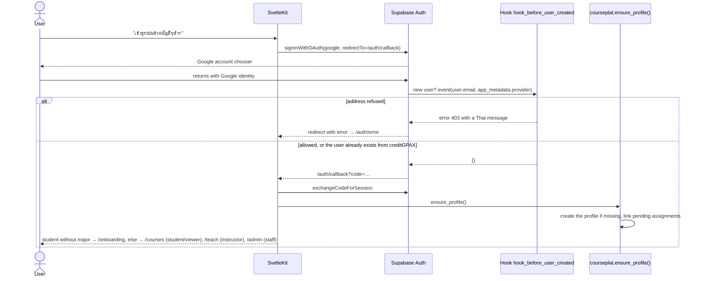

# 03 — Sign-in, roles and permissions

## Goal

Only PolSci students and Chula staff can sign in. Students can read published course information. Only people the department has listed can edit, and only the offerings they teach. Presenters can switch between a student, two instructors and a staff member in one click during the demo.

## Requirements

- R1. Sign-in uses Supabase Auth with **Google OAuth** as the real provider (decision D3 in spec 01).
- R2. Address rules, enforced in a Supabase **Before User Created** hook, so a refused address never becomes a user:
  - Student: `^[0-9]{8}24@student\.chula\.ac\.th$` (10-digit student ID ending in faculty code 24)
  - Staff: `^[a-z0-9._%+-]+@chula\.ac\.th$`
  - Anything else is refused with a Thai message.
  - Email/password sign-in is allowed **only** for addresses in `demo_accounts`. Any other email/password sign-up is refused, even for a Chula address.
- R3. Role on first sign-in to PA CoursePlat (`courseplat.ensure_profile()`, called right after the session is created and whenever a signed-in user has no profile; no trigger on `auth.users`, because the project is shared with creditGPAX, spec 02):
  - Student pattern → `student`, `cohort` = first two digits of the ID (`6712345624` → 67), `major` = null until onboarding.
  - Staff pattern and in `staff_directory` → that row's role (`instructor` or `staff`) and its names.
  - Staff pattern, not in the directory → `viewer` (read-only, like a student, with a banner explaining how to get edit access).
  - Demo address → role, cohort and major from `demo_accounts`; `is_demo = true`.
- R4. When staff add an address to `staff_directory` and that person already has a profile, the role updates immediately (trigger on `staff_directory` insert/update). Removing the row demotes them to `viewer`.
- R5. Capabilities by role:

| Capability | student | viewer | instructor | staff |
|---|---|---|---|---|
| Browse published offerings, compare, curriculum map | ✓ | ✓ | ✓ | ✓ |
| Curriculum badges ("required for you") | ✓ (needs major) | — | — | — |
| See drafts | — | — | own offerings | all |
| Edit syllabus, import with AI, publish | — | — | own offerings | all |
| Edit section notes and meeting times | — | — | own sections | all |
| Content Caution dashboard `/cautions` (see, resolve, comment) | — | — | pairs involving their offerings | all |
| Handover notes (read / write) | — | — | ✓ / ✓ | ✓ / ✓ |
| Semesters, offerings list, sections, instructor assignment | — | — | — | ✓ |
| Staff directory | — | — | — | ✓ |

"Own offering" means the instructor is the offering's coordinator or appears in `section_instructors` for any of its sections (`can_edit_offering`, spec 02).

- R6. Students choose their major once on `/onboarding` (GOV, IR, SOC, PA; PA preselected because this is the PA department's platform). They can change it in their profile.
- R7. Every route except `/`, `/auth/*` and the error page requires a session. Role checks happen on the server in `+layout.server.ts` / `+page.server.ts`, not only in the UI.

## Proposed approach

### Flow



Do not pass Google's `hd` parameter: students and staff sign in from two different domains, and `hd` is only a hint anyway. The hook is the real gate.

### Demo sign-in (only when `PUBLIC_DEMO_MODE=true`)

The landing page shows a "บัญชีตัวอย่างสำหรับการสาธิต" panel with four buttons. Each posts to a server action `/auth/demo` with the account key; the server signs in with `signInWithPassword(email, DEMO_ACCOUNT_PASSWORD)` and sets the session cookie. The password never reaches the browser bundle. When `PUBLIC_DEMO_MODE` is not `true`, the route returns 404 and the panel is not rendered.

| Key | Email | Role | Shown as | Used for |
|---|---|---|---|---|
| `student` | `student.pa67@courseplat.test` | student, cohort 67, major PA | นิสิตตัวอย่าง (PA ปี 3) | Browsing, compare |
| `prof-natthida` | `natthida.k@courseplat.test` | instructor | อ.ดร.ณัฐธิดา แก้วมณี | Uploads 2404429 in the demo |
| `prof-thanakrit` | `thanakrit.w@courseplat.test` | instructor | ผศ.ดร.ธนกฤต วงศ์ประเสริฐ | Owner of 2404324, receives the "coordinate" thread |
| `staff` | `onuma.j@courseplat.test` | staff | คุณอรอุมา ใจงาม (เจ้าหน้าที่ภาควิชา) | Readiness board, caution review |

All demo people are fictional (spec 08 has the full list). `.test` is a reserved top-level domain, so these addresses can never belong to a real person.

### Hook and profile SQL (`0004_auth.sql`)

The Supabase project is shared with creditGPAX, which already uses `public.hook_before_user_created` (Google + PolSci student only). Do not change that function. Create `public.shared_before_user_created(event jsonb)` instead, modelled on creditGPAX's (`creditgpax/supabase/migrations/20261112000000_account_plan_sync.sql`: same grants to `supabase_auth_admin`, same revokes from `authenticated`/`anon`/`public`), and point the dashboard hook at it. Its rule is the union of both apps:

```
allow if
  (provider = 'google' and (email ~ student_regex or email ~ staff_regex))
  or (provider = 'email' and exists (select 1 from demo_accounts where email = lower(event->'user'->>'email')))
```

Read the provider from `event->'user'->'app_metadata'->>'provider'`. Verify the exact event shape against the current Supabase hook docs at build time. The seed script creates demo users through the Admin API (`auth.admin.createUser` with `email_confirm: true`), which also passes through this hook, so `demo_accounts` must be seeded **before** the users.

The hook only runs for **new** users. Someone who already signed up for creditGPAX passed the stricter student rule, so they can sign in to PA CoursePlat straight away.

`courseplat.ensure_profile()` (`security definer`, acts on `auth.uid()` only): if no profile exists, resolve the role as in R3 from the JWT email and provider, insert it, and link any `section_instructors.pending_email` rows for that address (spec 07); return the profile. `courseplat.sync_staff_role()` trigger on `staff_directory` for R4.

### SvelteKit wiring

- `src/hooks.server.ts`: create the `@supabase/ssr` server client from cookies; `event.locals.supabase`; `event.locals.getSession()` that validates with `auth.getUser()` (not just the cookie); load `profiles` once per request into `event.locals.profile`.
- `src/routes/+layout.server.ts`: return `profile` (role, names, cohort, major, is_demo) to every page.
- Route groups: `(public)` for `/`, `/auth/*`; `(app)` requires a session; `(app)/teach/**` and `(app)/cautions/**` require instructor or staff; `(app)/admin/**` requires staff. Menu items for those areas render only for the roles that can open them. Redirect with a Thai toast when the role is wrong.
- Header shows the role chip (นิสิต / ผู้เยี่ยมชม / อาจารย์ / เจ้าหน้าที่) and, for demo accounts, a "ข้อมูลตัวอย่าง" badge and a "สลับบัญชีตัวอย่าง" menu that signs out and back in as another demo account.
- Viewer banner: "บัญชีของคุณยังไม่มีสิทธิ์แก้ไขรายวิชา หากคุณเป็นอาจารย์ในภาควิชารัฐประศาสนศาสตร์ โปรดติดต่อเจ้าหน้าที่ภาควิชาเพื่อเพิ่มอีเมลของคุณในระบบ"

### Setup checklist (also in spec 08)

1. Use the existing Supabase project shared with creditGPAX. Copy `PUBLIC_SUPABASE_URL` and `PUBLIC_SUPABASE_PUBLISHABLE_KEY` from creditGPAX's `.env`; get `SUPABASE_SECRET_KEY` and `SUPABASE_DB_URL` from the dashboard. Run `npm run db:migrate` (never `supabase db push`). Add `courseplat` to the Data API's exposed schemas.
2. Authentication → Hooks: Before User Created → Postgres → switch from `public.hook_before_user_created` to `public.shared_before_user_created`. Then check that creditGPAX sign-in still works for a PolSci student.
3. Authentication → Providers: Google is already set up for creditGPAX; keep it. Switch Email on (needed for demo accounts; the hook refuses everyone else). Keep Phone and anonymous sign-in off.
4. URL configuration: keep creditGPAX's Site URL; add PA CoursePlat's redirect URLs for the Vercel domain and `http://localhost:5173/auth/callback`.
5. The Google client secret stays only in the Supabase dashboard, never in either repo.

## Files / modules affected

`supabase/migrations/0004_auth.sql`, `src/hooks.server.ts`, `src/app.d.ts` (locals types), `src/routes/(public)/+page.svelte` (landing and sign-in), `src/routes/(public)/auth/callback/+server.ts`, `src/routes/(public)/auth/demo/+page.server.ts` (action), `src/routes/(public)/auth/error/+page.svelte`, `src/routes/(app)/onboarding/+page.svelte`, `src/routes/(app)/+layout.server.ts`, `src/lib/domain/curriculum.ts` (`cohortFromEmail`, `curriculumForCohort`).

## Acceptance criteria

1. Unit: `cohortFromEmail('6712345624@student.chula.ac.th') === 67`; `curriculumForCohort(67) === 'polsci-2564'`; `curriculumForCohort(69) === 'polsci-2569'`; `curriculumForCohort(70) === 'polsci-2569'`; cohort 65 falls back to `polsci-2564` with a notice flag.
2. Regex table test: accepts `6712345624@student.chula.ac.th`, `somchai.j@chula.ac.th`; refuses `6712345621@student.chula.ac.th` (faculty 21), `671234524@student.chula.ac.th` (9 digits), `someone@gmail.com`, `x@chula.ac.th.evil.com`.
3. Hook test (SQL, calling the function with crafted events): Google + student address passes; Google + gmail fails; email provider + `student.pa67@courseplat.test` passes; email provider + `somchai.j@chula.ac.th` fails. The Google + PolSci-student case is creditGPAX's own rule, so this test also guards creditGPAX.
4. With the four demo accounts: each lands on its home route; the student cannot open `/teach`, `/cautions` or `/admin` (redirect plus toast) and sees none of those menu items; `prof-natthida` can open the editor for 2404429 but gets a 403 page for 2404324's editor; `staff` can open every editor.
5. Adding `natthida.k@courseplat.test` → role `staff` in `/admin/people` changes her header chip after a page reload without signing in again; removing the row makes her `viewer`.
6. With `PUBLIC_DEMO_MODE` unset, `/auth/demo` returns 404 and the demo panel is absent.
7. An auth user created through the Admin API with a PolSci student address and no PA CoursePlat profile (standing in for an existing creditGPAX user) signs in and gets a `student` profile from `ensure_profile()`; calling creditGPAX's `put_plan` with a demo or staff account's JWT is still refused.

## Non-goals

Microsoft sign-in (documented fallback only), self-service access requests, multi-factor authentication, full PDPA documentation. For a real pilot, the department would need a short privacy notice: what is stored (email, cohort, chosen major; no grades, no student names), where (Supabase, Singapore region), and how to ask for deletion.
