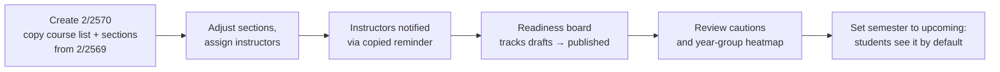

# 07 — Staff dashboard, semester setup and teaching continuity

## Goal

Department staff can set up a semester (which courses run, sections, instructors, times), see at a glance which syllabi are ready before registration, review overlaps across the whole semester, and spot weeks where assessments pile up for a year group. The same data gives every course a memory: who taught it, what changed, and what the last instructor wanted the next one to know.

## Requirements

### Readiness dashboard `/admin`

- R1. Semester selector (default `upcoming`). Header tiles: offerings total, เผยแพร่แล้ว, ฉบับร่าง, ยังไม่เริ่ม, open cautions (high / medium, linking to the Content Caution dashboard `/cautions`, spec 06), days until `syllabus_due_on`, and (Should) **AI วันนี้**: Gemini calls since the last free-tier reset (Pacific day) with the next reset in Bangkok time, and ThaiLLM calls today, both from `ai_calls`.
- R2. Readiness table: course code and name, coordinator, instructors (all sections), status chip, last edited (relative), open cautions by severity, link to the editor and to the student view. Sort by status (not started first) and by due date.
- R3. **ข้อความเตือน** button: generates a polite Thai reminder listing the not-started and draft offerings with their instructors and the due date, ready to copy into LINE or email (no sending from the app).
- R4. **Workload by year group**: for the selected semester, one heatmap per course level (ชั้นปี 2, 3, 4 from the 5th digit of the code; 2400114 as ชั้นปี 1). Rows = offerings at that level; columns = weeks 1–16 plus "ช่วงสอบปลายภาค"; cells = assessed weight due (spec 04's `weeklyLoad`). A "รวม" row per group, with weeks where the group total is ≥ 60% outlined and listed underneath ("สัปดาห์ที่ 12: 2404317 รายงานภาคสนาม 30%, 2404324 Policy brief 20%, 2404312 รายงานกรณีศึกษา 15%"). Drafts are included, marked with a dashed outline.
- R5. **PLO coverage this semester** (Should): the matrix from spec 04 R4, but counting drafts too, with a warning chip on any PLO1D–PLO5D column that no offering in the semester maps a CLO to.

### Semester setup

- R6. `/admin/semesters`: list; create (id `2570-1`, label `1/2570`, year, term, start date, weeks, syllabus due date, status). A partial unique index allows one `active` and one `upcoming` semester at a time; changing status shows what will move.
- R7. **Copy from a previous semester**: choose a source semester; the target gets the same course list, sections (numbers, languages, capacities, notes) and instructor assignments, with meetings optional (checkbox). Syllabi are **not** copied; offerings start `not_started`. Instructors later choose "copy from previous" themselves (spec 05), so the decision stays with the person who teaches.
- R8. `/admin/semesters/[semesterId]`: add or remove offerings (course picker over the catalog; removing an offering that has a draft asks for confirmation); set the coordinator; manage sections: number, language, capacity, note; instructors per section (people picker over profiles with role instructor/staff, plus "ยังไม่เคยเข้าสู่ระบบ" people from `staff_directory`, plus a free-text guest lecturer); meetings per section (weekday, start, end, room, mode). Overlapping meetings for the same instructor in the same semester show a warning.
- R9. Assigning someone who has never signed in: store `section_instructors.pending_email` (new nullable column; the check becomes `profile_id is not null or guest_name is not null or pending_email is not null`). `courseplat.ensure_profile()` (spec 03) links pending rows to the new profile on first sign-in, so they can edit immediately.

### People `/admin/people`

- R10. CRUD on `staff_directory`: email (lower-cased), role (instructor / staff), title, Thai and English names. Shows whether each person has signed in and which offerings they teach this semester. Removing a person who teaches an active or upcoming offering asks for confirmation and lists those offerings.

### Continuity (shared with spec 05)

- R11. **Course history** on `/courses/[code]` (for everyone) and in the editor sidebar (for instructors): every published version with semester, instructors (from the snapshot) and publish date; open any version read-only; diff any two versions (Should).
- R12. **Handover notes** (`course_notes`): any instructor or staff member can add a note to a course; notes show author, semester and date; authors can delete their own. The editor sidebar shows notes for the course being edited, newest first, and highlights notes added since the instructor last opened that course's editor.
- R13. **Who taught what**: `/admin/courses/[code]` (Should) lists offerings by semester with instructors, status, and the number of cautions raised and how they were resolved.

### Catalog (Could)

- R14. `/admin/catalog`: read-only list of courses with their curriculum categories; staff may edit `description_th` / `description_en` (for example to correct the PDF-derived Thai text), which is recorded in a simple `catalog_edits` log.

## Proposed approach

- All staff pages are SvelteKit pages with form actions; writes go straight to tables under the `is_staff()` RLS policies (spec 02), so no extra functions are needed except `copy_semester(source, target, include_meetings)` (one transaction).
- The readiness table and heatmaps come from one server load per semester: offerings + sections + instructors + `syllabus->'evaluation'` + `syllabus->'keyDates'` + caution counts (a grouped query). About 20 offerings, so no pagination.
- Reuse `Heatmap` and `weeklyLoad` from spec 04.
- The reminder text is built client-side from the loaded rows; copy with `navigator.clipboard.writeText` and show a toast.

## Files / modules affected

`src/routes/(app)/admin/+page.*` (dashboard), `admin/semesters/+page.*`, `admin/semesters/[semesterId]/+page.*`, `admin/people/+page.*`, `admin/courses/[code]/+page.*` (Should), `admin/catalog/+page.*` (Could); migration for `section_instructors.pending_email`, the partial unique indexes on `semesters.status`, `copy_semester`, and the pending-link step in `ensure_profile`; `src/lib/components/admin/**`.

## Acceptance criteria

1. As `staff`, right after `npm run demo:reset`, `/admin` for 2/2569 shows 14 offerings: 10 published, 1 draft (2404318), 3 not started (2404429, 2404480, 2404220).
2. **ข้อความเตือน** produces Thai text naming 2404429, 2404480, 2404220 and the draft 2404318 with their instructors and the due date.
3. The ชั้นปี 3 heatmap outlines week 12 and names the items due there; the ชั้นปี 4 heatmap includes 2404412's milestones.
4. Creating 1/2570 by copying from 1/2569 creates the same offerings as `not_started`, with sections and instructors and no syllabus.
5. Assigning `pending.prof@courseplat.test` (added to `demo_accounts` and the directory by a test fixture) to a section, then creating that user, links the assignment and lets them open the editor.
6. A meeting time changed by staff appears on the student course page on the next load.
7. Trying to set a second semester to `upcoming` fails with a clear Thai message.
8. The history of 2404429 shows 2/2568 taught by ผศ.ดร.ธนกฤต วงศ์ประเสริฐ and, after the demo publish, 2/2569 by อ.ดร.ณัฐธิดา แก้วมณี; the handover note from 2/2568 is visible in the 2/2569 editor.
9. As `prof-natthida`, every `/admin/**` route redirects to `/teach` with a toast.

## Non-goals

Email or LINE sending, approval workflows (a head of department signing off a syllabus), room booking, importing the official class schedule from the registration system, analytics beyond the dashboard tiles.
