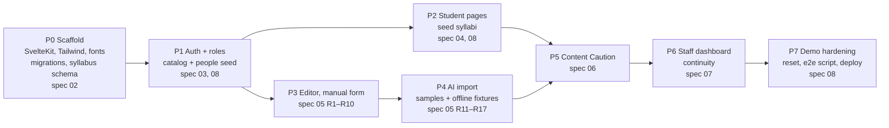

# PA CoursePlat — implementation specs (demo)

A central syllabus platform for the Public Administration department, Faculty of Political Science, Chulalongkorn University. Professors upload or write each semester's syllabus into one structured form; the platform warns them about overlapping content and assignments across courses (Content Caution); students read clear course pages and compare courses before registering. The target is a demo that is 90–100% working for a presentation to the department.

## Read in this order

| # | File | What it settles |
|---|---|---|
| 01 | [01-concept.md](01-concept.md) | Problem, users, the five design decisions, the nine information sections, scope, decision points D1–D8 |
| 02 | [02-architecture-and-data-model.md](02-architecture-and-data-model.md) | Stack, layout, database tables, functions, RLS, the syllabus schema |
| 03 | [03-auth-and-roles.md](03-auth-and-roles.md) | Supabase sign-in, address rules, roles, demo accounts |
| 04 | [04-student-experience.md](04-student-experience.md) | Course list, course page, compare, workload heatmap, curriculum map |
| 05 | [05-syllabus-editor-and-ai-import.md](05-syllabus-editor-and-ai-import.md) | Instructor workspace, manual form, AI import from .docx/PDF/image/text, review screen, offline fixtures |
| 06 | [06-content-caution.md](06-content-caution.md) | Overlap detection: rules + AI + severity, resolution flow, and the Content Caution dashboard (professors and staff only) |
| 07 | [07-staff-dashboard-and-continuity.md](07-staff-dashboard-and-continuity.md) | Readiness board, semester setup, people, history and handover notes |
| 08 | [08-seed-data-and-demo-script.md](08-seed-data-and-demo-script.md) | Seed data with planted overlaps, sample files, the 10-minute demo script, e2e tests, definition of done |

Supporting data in [`../data/`](../data/README.md): the real PA course catalog (34 courses, official Thai/English descriptions), curriculum 2564/2569 structure for PA, PLOs, and one complete example syllabus.

## Build order

At the end of each phase, run that phase's acceptance criteria, then commit. "Must" items come before "Should"; "Could" items only after the definition of done in spec 08 is met.

## Working agreements for the implementer

- These specs are the only context. When something is ambiguous, pick the simplest option that fits spec 01's decisions and record it in `specs/DECISIONS.md` (create it; append-only: date, spec, decision, reason).
- The syllabus schema in spec 02 is a contract shared by the editor, the AI, the student pages, Content Caution and the fixtures. Changing it means updating `data/examples/2404324-2569-2.json`, all fixtures and the tests in the same commit, and logging it in `DECISIONS.md`.
- Ask Kim only for things you cannot create yourself: the Supabase secret key and database URL (the project is shared with creditGPAX; its URL and publishable key are in creditGPAX's `.env`), the Gemini API key and the ThaiLLM API key (Kim has both; see the note in `CLAUDE.md` about `api.md` and `thaillm-api.md`), and the Google OAuth client.
- Verify third-party APIs against their current documentation while building (Supabase auth hooks, `@supabase/ssr`, Gemini `generateContent` structured output (`responseJsonSchema`), PDF input and free-tier limits, ThaiLLM's OpenAI-compatible endpoint and which `response_format` options it accepts, Vercel function duration). The specs name the features; the docs decide the exact syntax.

## Decision points (defaults already chosen)

See the table at the end of spec 01. In short: one syllabus per offering (D1); PolSci students only (D2); Google sign-in with a Microsoft fallback if Chula blocks it (D3); Content Caution shown only in a professor/staff dashboard, each professor seeing their own courses' pairs (D4); all assigned instructors can edit a team-taught syllabus (D5); 2569 official descriptions and PLOs for all cohorts (D6, D7); two free AI services behind one replaceable interface: Gemini reads documents, ThaiLLM judges overlaps and backs up text extraction (D8).
